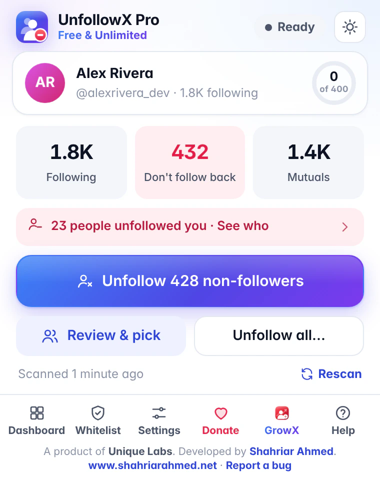
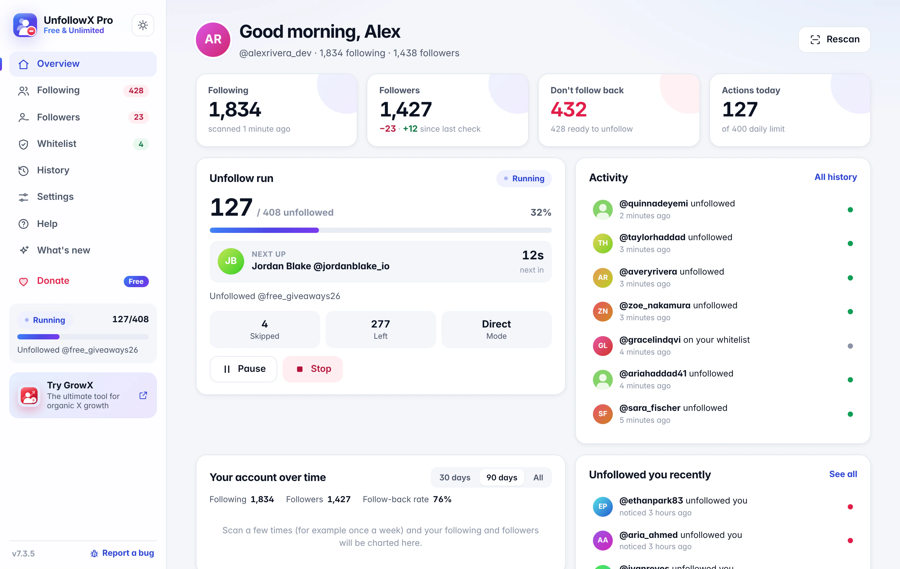
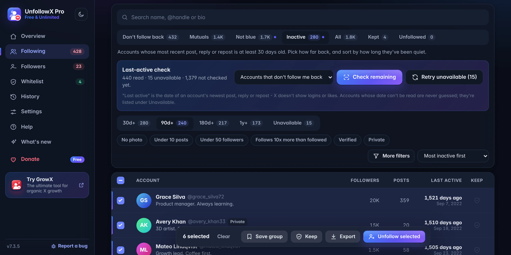

<div align="center">


<picture>
  <source media="(prefers-color-scheme: dark)" srcset="https://readme-typing-svg.demolab.com?font=Fira+Code&amp;weight=600&amp;size=22&amp;duration=3600&amp;pause=700&amp;color=7DD3FC&amp;center=true&amp;vCenter=true&amp;width=780&amp;height=48&amp;lines=Marketing+site+for+UnfollowX+Pro;Free+forever+Chrome+extension+for+X;Next.js+16+App+Router;Blog%2C+guides%2C+and+localized+landings;Live+at+www.unfollowx.com" />
  <source media="(prefers-color-scheme: light)" srcset="https://readme-typing-svg.demolab.com?font=Fira+Code&amp;weight=600&amp;size=22&amp;duration=3600&amp;pause=700&amp;color=0369A1&amp;center=true&amp;vCenter=true&amp;width=780&amp;height=48&amp;lines=Marketing+site+for+UnfollowX+Pro;Free+forever+Chrome+extension+for+X;Next.js+16+App+Router;Blog%2C+guides%2C+and+localized+landings;Live+at+www.unfollowx.com" />
  
</picture>

<em>Statically generated Next.js site for <a href="https://www.unfollowx.com/">UnfollowX Pro</a>, the free-forever Chrome extension for managing who you follow on X (Twitter).</em>

<br/>

<a href="https://www.unfollowx.com/"></a>
&nbsp;
<a href="https://chromewebstore.google.com/detail/unfollowx-pro-%E2%80%93-free-unli/igpjmagghnibmjkkdcgpjgpkfkpiglnl"></a>

<br/>


</div>

<br/>

| | | |
| --- | --- | --- |
| **Visit** | **Build** | **Read** |
| [www.unfollowx.com](https://www.unfollowx.com/) | `npm run dev` → `http://localhost:3000` | 15 articles, plus landings in six languages |
| Canonical host, on Vercel | Node.js 20.9+ and npm | English pages stay the full site |

## The site

This repository is the marketing site for [UnfollowX Pro](https://www.unfollowx.com/). The extension itself lives in a separate repository. The site explains the product, publishes how-to guides, and sends people to the [Chrome Web Store listing](https://chromewebstore.google.com/detail/unfollowx-pro-%E2%80%93-free-unli/igpjmagghnibmjkkdcgpjgpkfkpiglnl).

Next.js 16 App Router (JavaScript), statically generated, deployed on Vercel. Runtime dependencies are `next`, `react`, and `react-dom`. The lockfile currently resolves Next.js 16.4.5 and React 19.3.1. `package.json` tracks both as `latest`.

UnfollowX Pro is an independent product. It is not affiliated with, endorsed by, or sponsored by X Corp. X and Twitter are trademarks of their owners.

## Pages

The pages describe the extension. Every feature in `lib/features.js` was checked against the extension source.

<div align="center">

<a href="https://www.unfollowx.com/"></a>
<a href="https://www.unfollowx.com/features"></a>
<a href="https://www.unfollowx.com/mass-unfollow-twitter"></a>
<a href="https://www.unfollowx.com/twitter-non-followers-checker"></a>
<a href="https://www.unfollowx.com/x-follower-tracker"></a>
<a href="https://www.unfollowx.com/blog"></a>
<a href="https://www.unfollowx.com/faq"></a>
<a href="https://www.unfollowx.com/setup"></a>

</div>

| Area | What ships |
| --- | --- |
| English pages | Home, features, mass unfollow, non-followers, follower tracker, Circleboom alternative, setup, guides, FAQ, privacy, about |
| Localized landings | `/es`, `/pt-br`, `/hi`, `/id`, `/tr`, `/ar`, from the official store translations. Arabic is right to left |
| Blog | 15 articles in `content/articles/`, rendered with the Markdown subset in `lib/markdown.js`. RSS at `/feed.xml` |
| On-page product UI | Hero dashboard and an interactive demo. Sample accounts are labelled and are not connected to X |
| Screenshots | Real extension captures in `public/images/screenshots/` (WebP) |
| SEO | Per-page metadata, canonicals, hreflang, sitemap, robots, JSON-LD, PNG Open Graph images, and `/llms.txt` |
| Analytics | Google tag on every page: GTM `GTM-M4QHPXQV` delivers GA4 `G-DEEP3H3Q83`, with Consent Mode v2 |
| Theme | Light and dark. The choice is stored in the browser as `unfollowx-theme` |

<div align="center">

<picture>
  <source media="(prefers-color-scheme: dark)" srcset="public/images/screenshots/unfollowx-pro-popup-scan-results-dark.webp" />
  <source media="(prefers-color-scheme: light)" srcset="public/images/screenshots/unfollowx-pro-popup-scan-results-light.webp" />
  
</picture>



<sub>Extension screenshots already in this repo. The site captions them as the real interface with sample accounts.</sub>

</div>

## Stack

| Piece | In this repo |
| --- | --- |
| Framework | Next.js 16 App Router, React 19, JavaScript (no TypeScript) |
| Rendering | Static generation at build time. Article Markdown is read with `fs` during the build |
| Styling | CSS in `app/styles/` (tokens, base, components, home, pages, locale). No CSS framework |
| Fonts | Self-hosted Inter and Bricolage Grotesque (variable woff2, OFL) |
| Tooling | npm, ESLint 9 with `eslint-config-next` |
| Hosting | Vercel. Canonical host is `www.unfollowx.com` |
| Search ops | `scripts/seo-check.mjs`, `scripts/indexnow.mjs` |

## Run locally

**Requirements:** Node.js 20.9 or newer, and npm.

```bash
npm install
npm run dev
```

Open `http://localhost:3000`.

Production build:

```bash
npm run build
npm run start
```

`npm run start` serves the production build on port 3000.

## Environment

Optional environment variables, set in Vercel → Settings → Environment Variables. Names only. Values are the ownership tokens from each search console.

| Variable | Used for |
| --- | --- |
| `GOOGLE_SITE_VERIFICATION` | Google Search Console HTML-tag verification |
| `BING_SITE_VERIFICATION` | Bing `msvalidate.01` meta tag |
| `YANDEX_VERIFICATION` | Yandex verification meta tag |

See `SEO/indexing-action-plan.md`. The tags render only when the matching variable is set (`app/_root/RootDocument.jsx`).

`BASE_URL` is a shell variable for the SEO checker, not a Vercel setting. See [Ship](#ship).

Hand-updated facts live in `lib/site.js`:

- `EXTENSION.version` is the Chrome Web Store version shown on the About page and in `SoftwareApplication` structured data (currently `7.3.7`).
- `STORE_RATING` is the store rating shown in the homepage hero and in the same structured data. Update it by hand from the [reviews page](https://chromewebstore.google.com/detail/unfollowx-pro-%E2%80%93-free-unli/igpjmagghnibmjkkdcgpjgpkfkpiglnl/reviews). Last checked in source: **2026-11-22**, 4.9 from 54 ratings. Set it to `null` to hide both.

There are no secret values in this repository. The IndexNow key file in `public/` is public on purpose so search engines can confirm the site owner.

## Ship

| Command | What it does |
| --- | --- |
| `npm run dev` | Next.js dev server |
| `npm run build` | Production build |
| `npm run start` | Serve the production build |
| `npm run lint` | ESLint |
| `npm run seo:check` | Technical SEO crawl. `npm run check:seo` is the same script |
| `npm run indexnow` | Tell IndexNow about every URL in the live sitemap |

<details>
<summary><strong>Technical SEO check</strong></summary>

<br/>

`scripts/seo-check.mjs` has no extra dependencies.

```bash
npm run seo:check
npm run seo:check -- --build
BASE_URL=https://www.unfollowx.com npm run seo:check
```

With no `BASE_URL`, the script builds if `.next` is missing, starts `next start` on a free port, crawls `/sitemap.xml`, and stops the server. `--build` always rebuilds first. Set `BASE_URL` to check a site that is already running, including production.

For every sitemap URL it checks HTTP 200, a unique title and meta description, a self-canonical on the production host, hreflang (including `x-default`) with reciprocal links, index/follow, Open Graph and Twitter card with a 1200×630 PNG, exactly one `h1`, heading order, alt text, JSON-LD shape, a breadcrumb list on non-home pages, and internal links. It also checks `robots.txt`, 404 handling, and redirects.

</details>

<details>
<summary><strong>IndexNow</strong></summary>

<br/>

After deploying new or changed pages, notify Bing, Yandex, Naver, and Seznam:

```bash
npm run indexnow
```

The script reads `https://www.unfollowx.com/sitemap.xml` and POSTs the URL list to `https://api.indexnow.org/indexnow`. Google does not use IndexNow. Submit the sitemap in Search Console for Google.

</details>

<details>
<summary><strong>Add a blog article</strong></summary>

<br/>

1. Create `content/articles/<slug>.md`. Block syntax is documented at the top of `lib/markdown.js`: headings, lists, tables, `> [!NOTE]` / `> [!WARNING]` callouts, and one `[[cta]]` install box. Inline: bold, italic, code, links.
2. Add an entry to `registry` in `lib/blog.js` (title, `seoTitle`, description, category, icon, cover, dates, related).
3. Run `npm run build`. The article, its Open Graph image, and its sitemap entry are generated from that registry.

</details>

### Deploy to Vercel

Import this repository in Vercel (framework: Next.js, root directory: repository root, default build settings). Add `www.unfollowx.com` as the primary domain and point DNS to Vercel.

The app permanently redirects `unfollowx.com` and the `unfollowx-com.vercel.app` alias to `www.unfollowx.com`. Leave the reverse redirect (www → apex) unset in Vercel, or the two rules loop. Preview deployments on other `*.vercel.app` hostnames stay reachable. Then work through `SEO/launch-checklist.md`.

## Map

| Path | What |
| --- | --- |
| `app/` | Routes, metadata, OG images, sitemap, robots, manifest, RSS (`app/feed.xml`), `llms.txt`, styles (`app/styles/`), and self-hosted fonts |
| `app/(en)/` | English pages. `app/(locales)/[lang]/` is the localized landings |
| `components/` | Header, footer, consent and analytics, hero dashboard, interactive demo, FAQ accordion, cards |
| `content/articles/` | Blog article bodies |
| `content/i18n/`, `lib/i18n.js` | Localized landing copy (`/es`, `/pt-br`, `/hi`, `/id`, `/tr`, `/ar`) from the official store translations |
| `lib/site.js` | Store URL, contact details, extension version and facts, navigation |
| `lib/blog.js` | Article registry and categories |
| `lib/features.js`, `lib/faq.js` | Verified feature list and FAQ data. FAQ text and FAQPage JSON-LD share one source |
| `lib/seo.js`, `lib/og.jsx` | Metadata helper, JSON-LD builders, OG image renderer |
| `lib/analytics-config.js`, `lib/analytics.js` | Google tag on every page (GTM-M4QHPXQV + GA4 G-DEEP3H3Q83) with Consent Mode v2, consent updates, and events |
| `lib/markdown.js` | Build-time Markdown subset. No Markdown library is shipped |
| `public/images/screenshots/` | Real extension screenshots (WebP) |
| `scripts/` | `seo-check.mjs`, `indexnow.mjs` |
| `SEO/` | Keyword research, content roadmap, technical audit, internal linking map, launch checklist |
| `docs/` | Design system, implementation notes, analytics setup, GTM container export, test report |

## Copy rules

UnfollowX Pro is free forever: no pricing pages, premium tiers, or upgrade CTAs. Product claims must match the extension source. X platform limits must never be described as bypassed or guaranteed. See `docs/website-implementation.md` §4.

That section also requires labelled sample data, captioned real screenshots, an independent-product disclaimer, and no fabricated social proof. The visible store rating and the structured-data rating both come from `STORE_RATING` in `lib/site.js`.

## Editorial plan

Editorial decisions for the blog live in `SEO/content-roadmap.md` (last updated 2026-11-06): which of the proposed topics were published, merged, or covered by an existing URL, plus the standards for a new article. The live article list is the registry in `lib/blog.js`.

## Credits

Built and maintained by **[Shahriar Ahmed](https://github.com/fr-ost)**, Co-Founder & COO of **[Unique Labs](https://www.uniquelabs.org)**.

[shahriarahmed.net](https://www.shahriarahmed.net) · [Unique Labs](https://www.uniquelabs.org) · [UnfollowX Pro](https://www.unfollowx.com/)

Support on the site goes to the developer: [Telegram @igfrostt](https://t.me/igfrostt) and [shahriar.bmb@gmail.com](mailto:shahriar.bmb@gmail.com).

<div align="center">

<a href="https://github.com/fr-ost"></a>
&nbsp;
<a href="https://www.uniquelabs.org"></a>

<br/>


</div>
